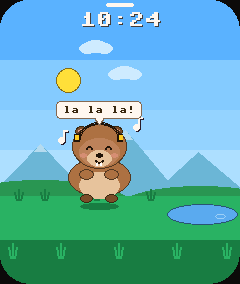
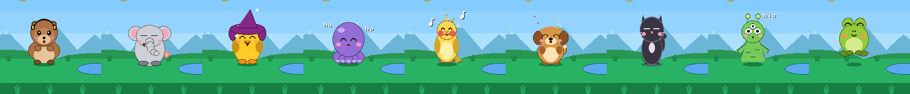
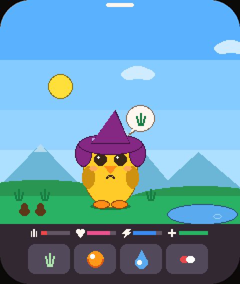
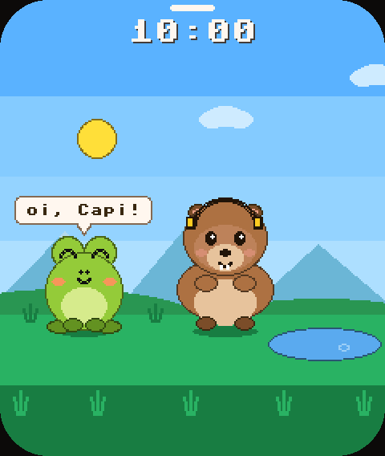
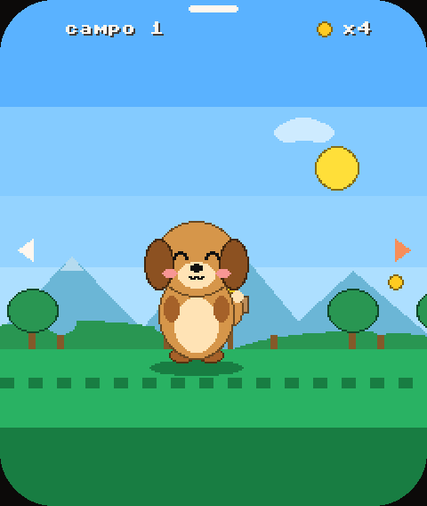
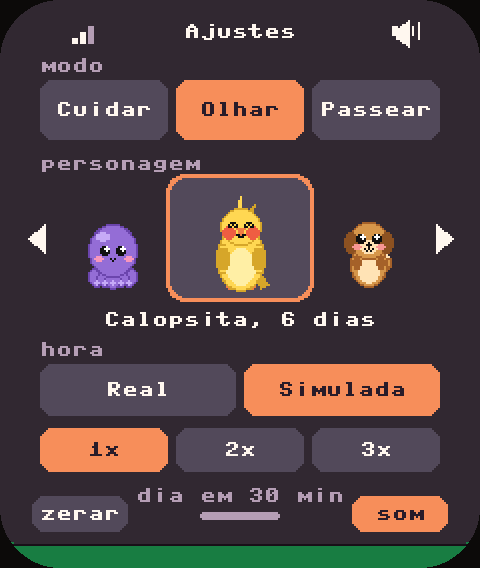
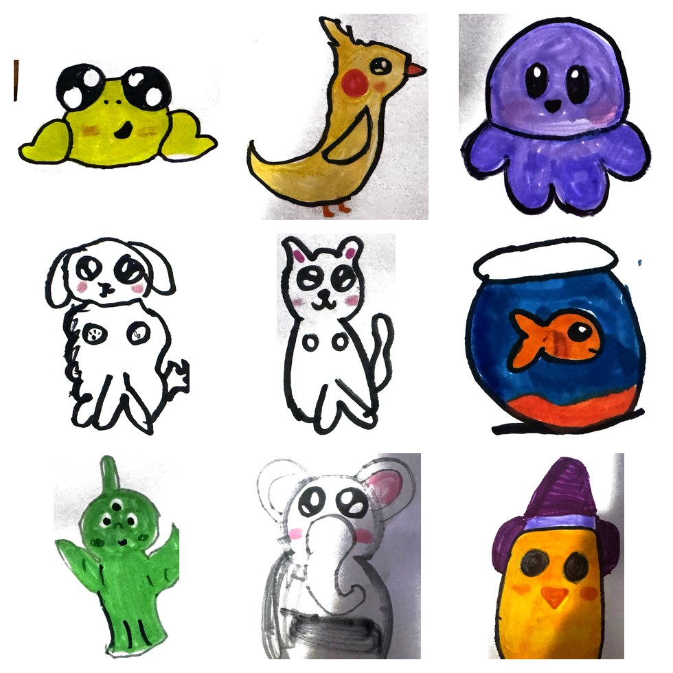
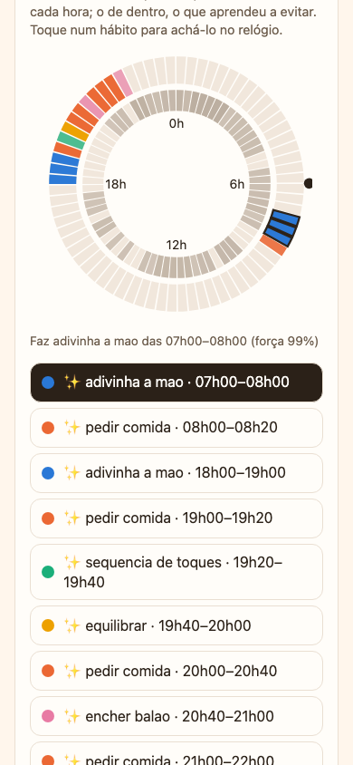

<p align="center">
  
</p>

<h1 align="center">Capigoshi</h1>

<p align="center">
  A pocket virtual pet with a tiny spiking brain, written in MicroPython for a little touch-screen board.<br>
  It hatches from an egg, grows up, plays, sleeps, learns your habits and, one day, becomes a star.
</p>

<p align="center">
  <a href="https://capigoshi.mundocapi.com">Website</a> ·
  <a href="https://capigoshi.mundocapi.com/cerebro.html">How the brain works</a> ·
  <a href="#getting-started">Getting started</a> ·
  <a href="#how-to-play">How to play</a> ·
  <a href="#the-brain">The brain</a> ·
  <a href="README.pt-BR.md">Português</a> ·
  <a href="CONTRIBUTING.md">Contributing</a> ·
  <a href="LICENSE">MIT License</a>
</p>

> 🇧🇷 **Leia em português:** [README.pt-BR.md](README.pt-BR.md)

---

## What it is

Capigoshi is a modern Tamagotchi that lives on a 1.83" board with a touch screen, accelerometer,
microphone, speaker and real-time clock. Everything on screen is drawn by code with ellipses,
rectangles, triangles and 8 × 8 text. There is not a single bitmap stored on the board.

**New in v1.5:** in **Watch** mode the pet is driven by a **spiking neural network** (an integer
leaky integrate-and-fire network with STDP and reward-modulated STDP) running on the ESP32-S3 itself. It
picks one of 100 actions every second and learns from you: what you praise, it repeats, at the hour you
praise it; what you ignore or scold, it slowly stops doing. Its memory survives power-offs, and you can
open an **X-ray** of its brain on your phone.

<p align="center"></p>

- **10 characters:** Capi, Elephant, Duck, Octopus, Cockatiel, Caramelo, Cat, ET, Froggy and Castaway.
  The original nine were drawn by João, age 9, and his lines were kept, not "fixed".
- **It is alive:** it breathes, picks one of 21 moves depending on the time of day (dance, somersault,
  smell a flower, hide in a hole, sneeze…) and talks in a minion voice.
- **It reacts:**
  - **tap:** a pat;
  - **press and drag:** you pick it up;
  - **shake the board:** it gets dizzy;
  - **noise:** it gets startled;
  - **10 min without attention:** it cries and calls you.
- **Life cycle:** the egg hatches in 10 min, then baby, adult and elder (walking stick and white
  eyebrows). Between 23 and 40 days later, one night, it becomes a star with its name in the sky, and in the
  morning a new egg appears.
- **A day-long diorama:** 6 sky phases, sun and moon on an arc, stars, clouds, mountains and a lake. It
  sleeps from 10 pm to 6 am.
- **Three modes:**
  - **Care:** hunger, joy, energy, health, poop and sickness.
  - **Watch:** it lives on its own, guided by its brain, with a routine and visitors.
  - **Walk:** a side-scroller with coins.
- **Online, if you want:** Wi-Fi set up from your phone (QR code, like a smart bulb), clock and weather
  from the internet, and two boards close together recognize each other and swap gifts, with no internet
  needed.

| Care | Watch (chatting with a neighbor) | Walk | Menu pulled from the top |
|:--:|:--:|:--:|:--:|
|  |  |  |  |

## Made by João

Capigoshi's characters, moves and actions were created by João, age 9. The code only translated each
line of his drawings to the screen, without correcting anything. See every drawing next to the pet it
became [on the project page](https://capigoshi.mundocapi.com/#joao).

<p align="center"></p>

## The brain

In Watch mode a small spiking neural network decides what the pet does. It is **integers only** (no
floats), fits in about 50 KB and runs on the board in real time.

```
 107 senses ──► 96 hidden neurons ──► 100 action neurons ──► the action with the most spikes in 1 s
 (time, touch,   (80 excitatory,       (dance, ask for food,
  shake, noise,   16 inhibitory,         call you, sleep…)
  battery,        recurrent)                  ▲
  drives…)                                    │ habit clock: 72 cells of 20 min
                                              │ learn "what I get praised for at this hour"
```

- **Neurons:** leaky integrate-and-fire. Each 50 ms tick, `v ← v + I − (v − v_rest)/16 + noise`;
  crossing the threshold fires a spike and resets to −200. Every second the network runs 20 ticks and the
  action neuron with the most spikes wins.
- **Unsupervised learning (STDP):** inputs that fire just before a hidden neuron get stronger
  connections; inputs that fire just after get weaker ones.
- **Reward learning (R-STDP):** each action leaves an *eligibility trace* on its synapses. When a reward
  `R` arrives (a star is +20, a pat +10, "shh" −15, being ignored −5…), the weights change by
  `Δw = η · R · e`, only for the action that earned it.
- **Habit clock:** 72 cells of 20 minutes, each wired to all 100 actions, learn *when* an action pays
  off. That is how it learns to ask for a pat at 7 pm if that is when you play with it.
- **Seven drives:** hunger, energy, mood, boredom, affection, curiosity and stress change minute by
  minute and feed back into the network. Hard rules on top: low energy means sleep; very hungry means ask
  for food.
- **Habituation and forgetting:** the same action rewarded again and again earns less; every day each
  weight moves 1% back towards its value at birth.
- **On the board:** the hot loops are compiled to machine code with `@micropython.viper` (one tick went
  from 16 ms to 2.7 ms). The brain is saved to `brain.bin` (with CRC and a backup copy) every 10 minutes
  and when it falls asleep.

👉 The full math, step by step, is on **[How the brain works](https://capigoshi.mundocapi.com/cerebro.html)**.
Calibration notes (every constant that differs from the original design, and why) are in
[`CALIBRACAO.md`](CALIBRACAO.md).

### Brain X-ray

Hold **BOOT** for 3 seconds, join the **Capigoshi** Wi-Fi network on your phone and tap **"Ver o
raio-X do meu cérebro"**. You will see its drives, its hour-by-hour habits on a 24 h clock, what it did
most today and yesterday, what it learned to avoid and its latest rewards.

<p align="center"></p>

## Hardware

- **Board:** [Waveshare ESP32-S3-Touch-LCD-1.83](https://www.waveshare.com/wiki/ESP32-S3-Touch-LCD-1.83)
  - ESP32-S3 with 8 MB PSRAM
  - 240 × 284 ST7789 display
  - CST816D touch
  - QMI8658 accelerometer
  - PCF85063 clock
  - ES8311 + ES7210 audio
  - AXP2101 power management
- **Lithium battery (optional):** the board has a connector. With a battery the clock keeps time and the
  screen warns you at 10%.
- **USB-C cable.**

## Getting started

You need Python 3 and a Mac or Linux machine (on Windows, run the step 3 commands by hand).

```bash
pip install esptool mpremote
git clone https://github.com/rjcaubit/capigoshi.git && cd capigoshi
```

**1. Put the board in flashing mode.** Hold **BOOT**, press and release **RST**, release **BOOT**.

**2. Flash everything.**

```bash
bash deploy.sh                 # downloads MicroPython, flashes it, copies the files and sets the clock
```

`deploy.sh` erases the board before flashing (including the pet and its learned brain). To update only
the files without losing your pet (board running normally, not in flashing mode):

```bash
bash deploy.sh --so-arquivos
```

**3. Without the script:** flash the `ESP32_GENERIC_S3-SPIRAM_OCT` firmware from
[micropython.org](https://micropython.org/download/ESP32_GENERIC_S3/) and copy the files:

```bash
mpremote cp main.py hw.py desenho.py vida.py rede.py portal.py : + cp -r sons : + cp companion/raiox.html :raiox.html
mpremote mkdir :companion
mpremote cp companion/*.py :companion/ + reset
```

### Extra sounds (optional)

The `sons/` folder ships with Kenney's effects (CC0). The minion voice and some nicer effects come from
Pixabay, whose license does not allow redistributing the raw files, so they are not in the repository. To
use them:

1. Open the links listed in [`sons/pixabay.sh`](sons/pixabay.sh) and click **Free download** on each.
2. Run `bash sons/pixabay.sh`. The sounds go to `sons/extra/`, which is git-ignored.

Without those files everything works the same, just without the voice.

### Time and Wi-Fi

The board's clock does not need the internet: `deploy.sh` sets it from your computer, and the menu has
**-1m / -1h / +1h / +1m** buttons. To use Wi-Fi, hold **BOOT** for 3 seconds: the board opens a network
called **Capigoshi** and shows a QR code. Point your phone's camera at it, pick your home network, type the
password and you are done. With Wi-Fi the board sets its clock and fetches the weather every 30 minutes.

## How to play

| Gesture | What happens |
|---|---|
| Pull the screen down from the top | Opens **Settings**: mode, character, Real or Simulated time (a day in 30, 15 or 10 min), sound, reset |
| Tap the pet | A pat. Five taps in a row and it says "enough tickling!" |
| Tap outside the pet | It looks around |
| **Watch mode:** hold your finger still on the pet for 1 s | ⭐ **Star**: praise for what it just did (last 3 s). It celebrates and learns to repeat it |
| **Watch mode:** hold your finger still on the background | 🤫 **Shh**: a gentle scolding. It hides and does that less from then on |
| Press and drag | You pick it up. It complains, and falls when you let go |
| Shake the board | It screams, wobbles and gets dizzy (in Watch mode it also counts as a scolding). If asleep, it wakes up for 1 minute |
| Noise nearby | It gets startled and looks around |
| Ignore its calls | Also teaches it: calls that never get an answer slowly fade away |
| Tap the egg | Warms it and speeds up hatching by 20 s |
| Care mode buttons | Eat, play, bath, medicine |
| Walk | Hold one side of the screen to walk. Short tap jumps. 3 quick taps on the same side: auto-walk |
| BOOT button | Closes the menu and leaves Walk. Hold 3 s: Wi-Fi and brain X-ray. 3 quick taps: offline mode |

Changing the character or tapping **reset** starts over with a new egg, and the game asks first.

## Try it without the board

The [`previa/`](previa/) folder runs the real firmware (`main.py`, `desenho.py` and `vida.py`, no copy
or imitation) on the desktop MicroPython. The hardware is simulated and the screens come out as PNGs:

```bash
brew install micropython        # or: apt install micropython
cd previa
micropython rodar.py            # runs the scenarios and tests (life cycle, menu, sleep, battery...)
python3 montar.py               # turns the screens into PNGs with the glass corners (needs Pillow)
```

`rodar.py` doubles as an automatic test: if a game rule breaks, it stops with an `AssertionError`.

The brain has its own simulator and tests, in plain CPython:

```bash
python3 -m unittest discover -s companion/testes -t .   # unit tests (network, learning, board bridge, X-ray)
python3 -m companion.sim.aceite todos                   # acceptance: a simulated week (speed, silence, habit)
python3 -m companion.sim.raiox                          # writes a brain X-ray page from a simulated owner
```

## Settings

The main constants live at the top of [`main.py`](main.py):

| Constant | What it controls | Default |
|---|---|---|
| `DORME`, `ACORDA` | Sleep hours | 10 pm and 6 am |
| `OVO_MINUTOS` | How long the egg takes to hatch (real minutes) | 10 |
| `VIDA_TOTAL` | Days of life, drawn when the egg appears | 23 to 40 |
| `FOME_MIN`, `CHANCE_DOENCA`… | Pace of Care mode | |
| `LIMIAR_GRITO`, `BARULHO_SEGUIDOS` | Microphone sensitivity | |
| `LIMIAR_SACUDIDA` | Shake strength, in g | 0.9 |
| `BATERIA_FRACA` | Battery warning threshold | 10% |

[`vida.py`](vida.py) holds the moves, each character's lines, the repertoire for each hour and the time
until it cries from loneliness (`IGNORADO_MS`). The brain's constants are in
[`companion/config.py`](companion/config.py).

## Project layout

```
main.py        game logic: modes, menu, life cycle, sensors, touch, brain bridge
vida.py        behavior: 21 moves, lines, reactions (no drawing, no hardware)
desenho.py     everything on screen: scene, characters, balloons, HUD, menu, effects
hw.py          drivers: display, touch, accelerometer, clock, audio and battery
rede.py        Wi-Fi, clock and weather from the internet, friends nearby (ESP-NOW)
portal.py      Wi-Fi setup portal and brain X-ray routes
companion/     the spiking brain: network, learning, drives, rewards, habit clock, board bridge, X-ray page
deploy.sh      flashes MicroPython and copies the files, setting the clock
sons/          .raw effects (16 kHz, 16-bit, stereo) and the Pixabay sounds script
previa/        runs the firmware on the computer and makes PNGs (also a test)
docs/          landing page and images
design_handoff_capigoshi_1c/   "1c Diorama" visual spec (colors, coordinates, reference renderer)
```

### How the drawing works

- **One source of truth.** `desenho.py` is a translation of a JS reference renderer
  (`design_handoff_capigoshi_1c/capigoshi-render.js`) that only uses what the board's `framebuf` has.
- **RGB565 colors.** Every color goes through RGB565.
- **Outlines.** Each shape's outline is the same shape 1 px larger, in the shape's color × 0.5.
- **Moves.** Moves stretch, mirror and rotate the character with a transform applied to every primitive,
  because `framebuf` has no `scale`, `rotate` or clipping.
- **Hiding in the hole.** For that move, the ground is repainted on top of the character.

## Troubleshooting

- **Image shifted or with a stripe:** adjust the `self._cmd(0x2B, ...)` line in `hw.py`.
- **Glitchy image:** lower `baudrate=40_000_000` to `24_000_000` in `hw.py`.
- **No sound or microphone:** the game keeps working and prints the reason in the Thonny or `mpremote`
  terminal. Audio is configured register by register, so it is the first thing to check.
- **It gets scared for no reason, or hears nothing:** set `MOSTRAR_VOLUME = True` in `main.py`, run it
  from Thonny and tune `LIMIAR_GRITO` by watching the numbers.
- **The board will not enter flashing mode:** hold BOOT, press and release RST, and only then release
  BOOT. The port is usually `/dev/cu.usbmodem101` on a Mac (`bash deploy.sh /dev/your-port` for another).
- **The battery warning never shows:** the board needs a battery on the connector. Without one, the
  power chip reports "no battery" and the warning stays off.
- **The brain started from scratch:** `brain.bin` is missing or corrupted and `brain.bak` too. A fresh
  brain is born with a new random seed; that is expected after `deploy.sh` without `--so-arquivos`.

The older, more detailed guide (in Portuguese) is [LEIA-ME.md](LEIA-ME.md).

## Roadmap

- [x] Weather, Wi-Fi from the phone and friends nearby (v1.4)
- [x] A spiking brain that learns from its owner, with an X-ray (v1.5)
- [ ] Spread the brain's decision over several frames (today the animation skips ~50 ms once a second)
- [ ] Mini-games and social actions between two Capis driven by the brain
- [ ] Seasons and holidays in Watch mode
- [ ] Buildings in the scene (campfire, little boat, hut)
- [ ] More characters drawn by kids. [Send yours!](CONTRIBUTING.md#novos-personagens)

## Contributing

Contributions are very welcome: code, characters, lines, translations and sounds. Read
[CONTRIBUTING.md](CONTRIBUTING.md) and the [Code of Conduct](CODE_OF_CONDUCT.md). Issues and PRs in
English or Portuguese are both fine.

## Credits and license

The code is under the [MIT license](LICENSE). Sounds, fonts and other third-party pieces have their own
licenses, listed in [CREDITOS.md](CREDITOS.md).
